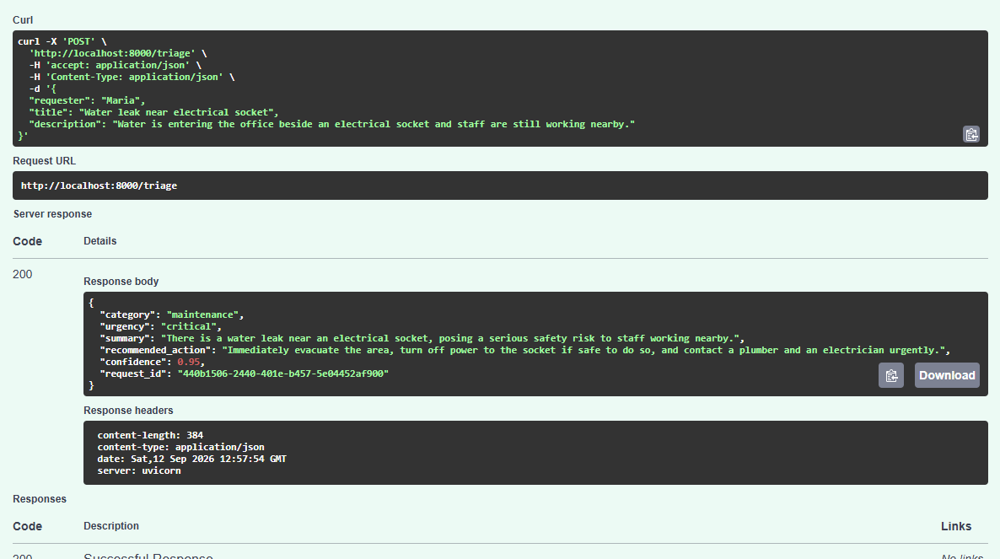

# Fabio Sousa Max | Python Automation & API Integrations

**Python · FastAPI · n8n · Make · REST APIs · OpenAI · Docker**

I build automation workflows and API integrations that turn incoming requests into validated, actionable results. Below are working portfolio projects with source code, setup instructions and test or screenshot evidence.

**Based in:** Canary Islands, Spain · **Languages:** Portuguese (native), Spanish and English · **Open to:** remote junior automation, integration and technical operations roles

[**Explore OpsPilot AI**](project-4-opspilot-ai/README.md) · [**View my CV**](docs/Fabio_Sousa_Max_CV.pdf) · [**Connect on LinkedIn**](https://www.linkedin.com/in/sousamaxfabio)

> **Demo status:** These are portfolio projects, not publicly hosted commercial services. Screenshots, source code, local run instructions and automated tests are linked below. No live public demo URL is claimed.

## Featured projects

### 01 — [OpsPilot AI: AI-powered operations triage](project-4-opspilot-ai/README.md)

**n8n + FastAPI + OpenAI + Docker Compose**

Receives operational requests through an n8n webhook, validates input, sends it to a Python API for structured AI triage, and returns category, urgency and recommended action. Includes a reproducible Docker setup, GitHub Actions CI, automated tests and a documented architecture.

[**See screenshot, workflow and how to run it →**](project-4-opspilot-ai/README.md)

### 02 — [SQL & FastAPI Service: validated API with tests](stage2-api-service/README.md)

**Python + FastAPI + PostgreSQL/SQLite + Docker + pytest**

A containerised backend service with authenticated GET/POST endpoints, Pydantic request validation, parameterised SQL, transactions, health/readiness endpoints and automated endpoint tests.

[**Explore endpoints, tests and setup →**](stage2-api-service/README.md)

### 03 — [Intelligent Invoice Processing: human-in-the-loop automation](day-19-production-improvements/README.md)

**n8n + OpenAI + Airtable + Gmail**

Extracts invoice information, validates it, routes cases for human approval, checks duplicates, logs outcomes and handles retries and notifications.

[**Explore workflow and evidence →**](day-19-production-improvements/README.md)

### 04 — [GitHub Repository Monitor: resilient Python API client](python-automations/stage-1-professional-python/github-repository-monitor/README.md)

**Python + REST APIs + pytest + Postman**

Demonstrates optional API authentication, pagination, timeout handling, retries with backoff, rate-limit handling, validation, structured logging and automated tests.

[**Explore code, tests and examples →**](python-automations/stage-1-professional-python/github-repository-monitor/README.md)

## Other practical work

- [Google Cloud deployment](gcp-cloud-deployment/README.md) — private Cloud Run deployment, IAM, secrets, logging and monitoring; **not a public demo endpoint**
- [AI service request classifier](day-14-ai-service-request-classifier/README.md) — webhook intake, OpenAI classification, validation, Sheets and Slack routing
- [Service request webhook API](service-request-api/README.md) — request validation, urgency routing and HTTP responses in n8n
- [AI CSV classification pipeline](python-automations/day-26-project3-part2/README.md) — file processing, OpenAI classification, retries and logging
- [SaaS identity and access review](saas-identity-security/README.md) — fictional onboarding/offboarding and permissions audit case study
- [Operations scripts toolkit](operations-scripts/README.md) — Bash, PowerShell, health checks and logs

## Technical toolkit

| Area | Tools and methods |
| --- | --- |
| Automation & integrations | n8n, Make, webhooks, REST APIs, JSON, Airtable, Gmail, Slack, Google Sheets |
| Python & backend | Python, FastAPI, Pydantic, SQL, PostgreSQL, SQLite |
| AI integrations | OpenAI API, classification, structured output, validation, human review |
| Testing & reliability | pytest, unittest, retries, error handling, logging, GitHub Actions |
| Deployment & operations | Docker, Docker Compose, Google Cloud, Linux, Bash, PowerShell |
| Identity fundamentals | IAM, RBAC, SSO, least privilege, access reviews |

## About me

I previously worked in enterprise IT support, investigating incidents and helping users in a multilingual environment. I now focus on building and troubleshooting automation systems, backend APIs and integrations.

**These are personal projects** demonstrating hands-on implementation, not paid client deployments or claimed certifications. Learning exercises remain in the repository for technical reference, but the featured projects above are the recommended starting point.

**Contact:** [LinkedIn](https://www.linkedin.com/in/sousamaxfabio) · [GitHub](https://github.com/sousamaxfabio) · [Email](mailto:sousamax.fabio@gmail.com)
