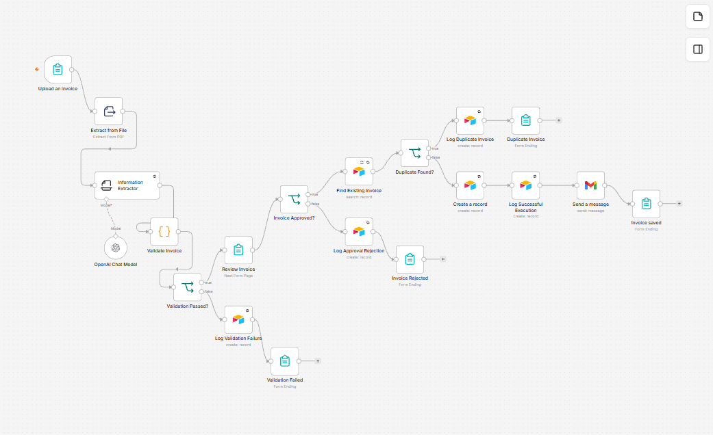
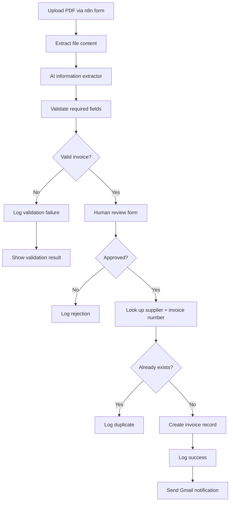

# Intelligent Invoice Processing | n8n + AI + Human Approval

**AI-assisted PDF extraction · validation · approval · duplicate checks · Airtable audit trail · failure notifications**

A portfolio workflow that processes uploaded invoices while keeping a person in control of approval. Rather than automatically saving everything extracted by AI, it validates essential fields, routes rejected or duplicate documents, logs outcomes and notifies the team.

**Status:** Reproducible n8n portfolio demonstration using fictional sample invoices. Not a publicly hosted or commercially deployed service.

[**View workflow screenshot**](screenshots/workflow-overview.png) · [**Import main workflow**](workflow.json) · [**Import error workflow**](failure-notification-workflow.json) · [**Try sample invoices**](sample-invoices/)

## Demonstration

This is an exported, inspectable workflow—not just an architecture proposal. The repository also contains **test PDFs**, **execution screenshots**, and an **error-notification workflow**.

| Evidence | Inspect |
| --- | --- |
| Successful invoice route | [Execution screenshot](screenshots/successful-execution.png) |
| Invalid / non-invoice document | [Validation screenshot](screenshots/incorrect-document-validation.png) |
| Missing payment deadline | [Missing-field screenshot](screenshots/missing-payment-deadline-validation.png) |
| Unexpected technical failure | [Failure execution](screenshots/technical-failure-execution.png) and [Gmail notification](screenshots/failure-notification-email.png) |
| Failure workflow itself | [Workflow screenshot](screenshots/failure-notification-workflow.png) |

## What the workflow does

1. Accepts an uploaded PDF through an **n8n Form Trigger**.
2. Extracts document content and uses an **OpenAI-backed information extractor** to structure invoice fields.
3. Runs a **Code node** to validate required information.
4. Requests **human approval** using an n8n form before saving anything.
5. Searches Airtable for an existing supplier/invoice-number combination.
6. Saves approved, valid, non-duplicate invoices in Airtable, records a success log and sends a Gmail notification.
7. Routes rejected, incomplete and duplicate invoices to their appropriate form results and audit records. A separate Error Trigger workflow sends email for unexpected execution failures.

## Architecture and decision routes

**Separate failure workflow:** `Error Trigger → Gmail failure notification`, configured in the main workflow's settings.

## Operational safeguards and failure handling

| Situation | Implemented behavior | Evidence / boundary |
| --- | --- | --- |
| Invalid or non-invoice document | Validation route; no new invoice record | [Example](screenshots/incorrect-document-validation.png) |
| Required data missing | Reject and log validation failure | [Example](screenshots/missing-payment-deadline-validation.png) |
| Human rejects an invoice | Record rejection; do not create invoice | Review and rejection nodes in [workflow.json](workflow.json) |
| Invoice already found in Airtable | Log duplicate; do not create another record in that execution | Search-before-create is **not** an atomic uniqueness guarantee |
| Temporary OpenAI/Airtable failure | Retry enabled on the information-extraction and selected Airtable nodes | Retries can still be exhausted; not all Gmail nodes retry |
| Unexpected workflow execution error | Dedicated error workflow sends a Gmail alert | [Failure workflow](failure-notification-workflow.json) · [screenshot](screenshots/failure-notification-email.png) |

The exported workflow enables retries on **Information Extractor**, **Find Existing Invoice**, **Create a record**, and the Airtable audit-log nodes. Validation and human approval are deliberate decision routes, **not** retry conditions.

## Manual verification scenarios

These are documented **manual workflow tests**, not an automated unit-test suite.

| Test case | Expected outcome | Documented result |
| --- | --- | --- |
| Valid, approved, unique invoice | Airtable record, audit log, Gmail success message | Passed |
| Previously stored supplier + invoice number | Duplicate route; no new invoice record | Passed |
| Non-invoice document | Validation failure and log | Passed |
| Invoice missing payment deadline | Validation failure before record creation | Passed |
| Deliberately triggered technical error | Separate failure-notification email | Passed |

See the linked screenshots above. The workflow is intended for controlled demonstration with fictional documents.

## Sample invoices

The [`sample-invoices/`](sample-invoices/) folder contains reproducible fictional documents:

| File | Purpose |
| --- | --- |
| [`sample-invoice.pdf`](sample-invoices/sample-invoice.pdf) | Exercise the valid invoice route |
| [`test-invoice-N8N-20260907-7F3C9A.pdf`](sample-invoices/test-invoice-N8N-20260907-7F3C9A.pdf) | Check unique versus existing invoice behavior |
| [`test-invoice-missing-payment-deadline.pdf`](sample-invoices/test-invoice-missing-payment-deadline.pdf) | Verify required-field validation |
| [`non-invoice-test-document.pdf`](sample-invoices/non-invoice-test-document.pdf) | Verify rejection of unrelated documents |

**To test duplicate handling:** process an invoice once, then submit the same invoice again without deleting its Airtable record.

## Run it yourself

**Prerequisites:** an n8n instance with Form Trigger support, OpenAI credentials, Airtable access, Gmail OAuth, and permission to create records in an Airtable base.

1. Import [`workflow.json`](workflow.json) and [`failure-notification-workflow.json`](failure-notification-workflow.json) into n8n.
2. Configure the OpenAI credential in **OpenAI Chat Model**.
3. Create the Airtable tables described below, then configure the Airtable nodes with your base/table and personal access token.
4. Configure the Gmail recipient and credential in the main workflow and in the failure workflow.
5. Activate the failure workflow. In the main workflow's settings, select it as the **error workflow**.
6. Save the main workflow and open its test form.
7. Upload a fictional [sample invoice](sample-invoices/) and inspect the n8n execution history, Airtable records and notifications.

**Configuration safety:** Workflow exports use recipient placeholders, not usable API credentials. Replace all base/table references, credential selections and recipient placeholders after import. Never commit access tokens.

### Airtable schema

Create an `Invoices` table containing:

| Field | Suggested type |
| --- | --- |
| Supplier, Invoice Number, Currency, Status | Text or appropriate single-select |
| Invoice Date, Payment Deadline | Date |
| Subtotal, VAT, Total | Number |
| Validation Issues | Long text |
| Approved at | Date and time |

Create an `Execution Logs` table containing:

| Field | Suggested type |
| --- | --- |
| Execution ID, Outcome, Status, Invoice Number, Supplier | Text or appropriate single-select |
| Timestamp | Date and time |
| Details | Long text |

## Stack and project files

**Stack:** n8n, OpenAI, Airtable, Gmail, JavaScript in n8n's Code node, PDF extraction, conditional routing.

- [`workflow.json`](workflow.json) — main export with the form, AI extraction, validation, human review, duplicate lookup, record creation and audit logs
- [`failure-notification-workflow.json`](failure-notification-workflow.json) — independent error-trigger notification
- [`sample-invoices/`](sample-invoices/) — fictional test inputs
- [`screenshots/`](screenshots/) — execution evidence

## Security, boundaries and next improvements

- Keep secrets in n8n's credential store, apply least-privilege access, and remove sensitive data from logs and screenshots.
- Test files contain fictional information; real invoice data requires an appropriate privacy and retention policy.
- **Duplicate lookup is best effort.** Concurrent executions can race; a production design needs a unique constraint or idempotency mechanism.
- Extracted AI fields require validation and human judgment. Image-only PDFs may need OCR or vision processing.
- A failed email or exhausted retry can still require manual recovery. Review error workflow coverage and notification delivery before operational use.
- Further hardening could include deterministic integration tests, explicit idempotency, retention controls and permission reviews.

[**Back to the portfolio overview**](../README.md)
