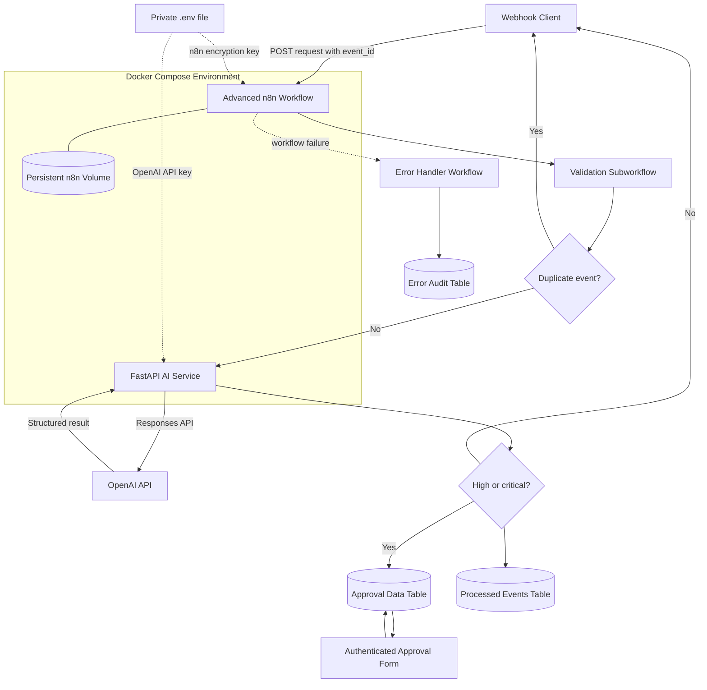

# OpsPilot AI Architecture

## Components

- **Advanced n8n workflow:** Coordinates validation, duplicate detection, AI triage, fallback behaviour, approval and audit records.
- **Validation subworkflow:** Normalises the webhook payload and rejects invalid requests before calling the AI service.
- **Error-handler workflow:** Captures failed workflow executions in an audit table.
- **FastAPI service:** Validates requests and produces structured AI triage results.
- **OpenAI API:** Analyses each operational request.
- **Data Tables:** Store processed event identifiers and human-approval decisions.
- **Authenticated approval form:** Pauses high- and critical-urgency requests until a reviewer approves or rejects them.
- **Persistent volume:** Preserves the Project 4 n8n configuration.
- **Private Docker network:** Allows n8n to reach the API as `http://ai-api:8000`.
- **Environment file:** Supplies runtime secrets without storing them in the image or repository.

